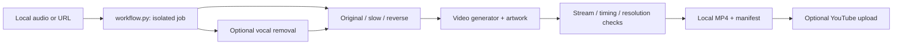

# Music and video workspace

## All scripts in one program

Double-click **Start Scripts Studio.cmd**, or run `python script_manager.py`.
This opens the new local browser dashboard. Scripts Studio provides guided forms for the main media tools, a searchable
browser of the other first-party scripts, command previews, progress logs,
job cancellation, and saved job history. See the [Studio guide](docs/SCRIPT_MANAGER.md)
for the clip-to-video workflow and advanced script arguments.

The dashboard has task cards, common inputs first, expandable **Advanced**
settings, video previews, and **Activity & results**. **Workspace cleaner** previews old Python
caches and completed job logs, moves selected items to restorable Studio Trash,
and lets you permanently empty selected trash batches to free disk space.
The earlier native interface is available with `python script_manager.py --desktop`.

## Desktop video creator

Double-click **Start Video Creator.cmd**, or run `python create_video.py`, to
open the Music Video Creator window.
Choose your audio file and a folder of photos/video clips, then click **Create
video**. The default makes a 15-second 480p preview; select **1080p full song**
for the complete track. Preview start and length apply only to previews.
Existing project artwork is selected initially; replace it with your own visuals
for your song. The program arranges supplied visuals using the renderer's music
analysis; it does not invent footage or automatically search online.

You can instead select a timeline exported by the clip finder to use your
reviewed highlights. A preview timeline must cover the chosen excerpt; a full
song timeline must cover the whole track. Each render saves a separate job under
`runs/`, preserving previous videos. **Open output folder** takes you to the MP4.
The window stays responsive and shows render logs. Normalization is off.

Without the window:

```powershell
python create_video.py --audio "my song.mp3" --visuals "my clips" --seconds 15
python create_video.py --audio "my song.mp3" --timeline "runs/my-timeline.json" --preset video
```

Use the Python environment with the workflow and renderer dependencies installed
(see below); FFmpeg and ffprobe must be on PATH. Tkinter is included with standard
Windows Python installations. `--dry-run` validates selections and prints the
renderer command without making a video.

**Folder map:** [Current organization](docs/STRUCTURE.md). Reusable components
are under `modules/`, song scripts under `projects/`, and orchestration helpers
under `pipelines/`. The root commands below remain the entry points.

This workspace contains reusable media tools, song-specific music projects,
and older automation experiments. The supported shared entry point is
`workflow.py`: it gives every job its own inputs, processed audio, video, and
progress record.

Start with the [workspace guide and four diagrams](docs/WORKSPACE_GUIDE.md).
Read the [audit and remaining blockers](docs/AUDIT.md) before unattended use.

For visual timelines, camera motion, framing, and crossfades, see
[the video editing guide](docs/VIDEO_EDITING.md).

For **preview/master/video presets, reference comparison, and optional
normalization**, see [the production guide](docs/PRODUCTION.md).

To hear and see how they work with generated demo music, follow
[the hands-on tests](docs/TRY_IT.md), or run `py -3.11 tools/demo_production.py`.

```powershell
.\run.ps1 workflow -Audio "mix.wav" -Preset master -Reference "reference.wav"
.\run.ps1 workflow -Audio "mix.wav" -Preset preview -PreviewSeconds 25
.\run.ps1 workflow -Audio "mix.wav" -Preset video
```

## Main workflow



```powershell
# From this folder: inspect the environment and run local checks
.\run.ps1 doctor
.\run.ps1 test
.\run.ps1 smoke

# Create a video from a file or a directory of audio
.\run.ps1 workflow -Audio "path/to/song.wav"
.\run.ps1 workflow -Audio modules/automatic_upload/downloads -Effect slow

# Choose artwork or explicitly request an upload
.\run.ps1 workflow -Audio "song.wav" -Images "path/to/artwork"
.\run.ps1 workflow -Audio "song.wav" -Upload -Privacy private
```

For URL input, custom video configuration, metadata, or a different Demucs
interpreter, use `py -3.11 workflow.py --help`. Direct Python commands use that
interpreter; the PowerShell runner prefers `.venv/Scripts/python.exe` if present
and otherwise uses `py -3.11`.

Each job writes to `runs/<date-time-id>/`. A failed required stage stops the
workflow. The manifest records its stage and error. Upload is opt-in and defaults
to private. Automatic job resume is not implemented.

## Setup and status

FFmpeg and ffprobe must be on PATH. On Windows, `.\run.ps1 setup` creates a
workspace `.venv`, installs `requirements/workflow.txt`, and installs the
Playwright browser used by the separate search tool. That requirements file is
a snapshot of direct versions used during the audit, not a full transitive lock.
The new setup path has not been exercised with a fresh network install.

For manual environment setup:

```powershell
py -3.11 -m venv .venv
.\.venv\Scripts\python.exe -m pip install -r requirements/workflow.txt
.\run.ps1 doctor
```

Vocal removal requires the separate environment in `modules/vocal-remover/`. Its current
PyTorch installation fails loading a native DLL, so `-Instrumental` is blocked
until that runtime is repaired. The health check reports this failure.

The global Python installation also has dependency conflicts. They are recorded
in the health report; do not treat package presence as proof of a working tool.

## Where to find things

| Location | Responsibility |
|---|---|
| `workflow.py`, `pipelines/` | Job coordination, batch processing, and technical output checks |
| `modules/automatic_upload/` | YouTube search/download, metadata, separate Pinterest automation |
| `modules/clip_finder/` | Independent online footage discovery and optional downloads |
| `modules/music_video_generator/` | Images/clips + audio into H.264/AAC video |
| `modules/automatic_YouTube_upload/` | OAuth upload, upload receipts, thumbnails |
| `modules/vocal-remover/` | Demucs separation and separate environment |
| `projects/soudeni/` | Song-specific MIDI, instruments, synthesis, mixing, and documents |
| `assets/`, `vendor/` | Shared soundfonts and downloaded third-party dependencies |
| `config/credentials/` | Local OAuth client configuration |
| `requirements/` | Workflow and optional production dependencies |
| `tools/`, `tests/` | Repeatable diagnostics and offline regressions |
| `runs/` | Isolated generated jobs; excluded from Git |
| `docs/` | Architecture, operating guide, audit, measured reports |

Finished WAVs from the song-specific projects can be passed to `workflow.py
--audio`. These scripts do not all run automatically as one creative pipeline;
the guide marks the manual handoffs and explains the order of project stages.

## Verification reports

- [Environment and syntax](docs/health-check.json)
- [Real local media smoke tests](docs/media-smoke.json)
- [Shared synth](docs/synth-smoke.json)
- [Earlier instrumental audio measurements](docs/audio-quality.json)

The audit ran local rendering and full-file audio measurements. It did not run
live search/download, external metadata generation, full vocal separation,
Pinterest publishing, or YouTube upload. Technical checks do not replace a
listening/watch-through of a finished song.

Older `pipelines/run_all.py`, Makefile `all`, and per-folder commands remain available.
They use shared folders and have different upload/cleanup behavior. Prefer the
isolated workflow for new work, and see the guide before using legacy batch or
clean commands. The later folder moves are recorded in
[folder-moves.json](docs/folder-moves.json); existing generated media was preserved.
