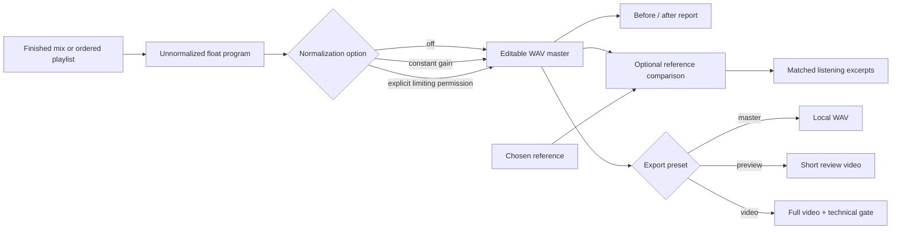

# Audio production exports and reference comparison

Use these tools on a finished mix from `projects/soudeni/`, another production
project, or any supported local audio file. Originals are preserved; outputs
belong to a new `runs/<job>/` directory. No upload occurs without `--upload`.

## Export presets

| Preset | Result | Defaults |
|---|---|---|
| `preview` | Short review video and the excerpt's WAV | First 30 seconds, 854×480, 24 fps, CRF 26, AAC 160k |
| `master` | Editable WAV without video; artwork is not required | 48 kHz stereo, 24-bit PCM |
| `video` | Full video plus a retained editable WAV | 1920×1080, 30 fps, CRF 20, AAC 256k; 48 kHz stereo audio |

Normalization is **off for all presets**. A master is an editable mixdown, not a
multitrack session or a set of isolated instrument stems. Exporting compressed
source audio as WAV does not recover information already lost in the source.

```powershell
# Editable master; no images needed
.\run.ps1 workflow -Audio "projects/my-song/mix.wav" -Preset master

# Floating-point WAV for further processing
.\run.ps1 workflow -Audio "projects/my-song/mix.wav" -Preset master -WavFormat float

# Preview a selected part of the mix
.\run.ps1 workflow -Audio "projects/my-song/mix.wav" -Preset preview -PreviewStart 45 -PreviewSeconds 25

# Full video and retained WAV, with your artwork
.\run.ps1 workflow -Audio "projects/my-song/mix.wav" -Images "projects/my-song/artwork" -Preset video
```

Use `-SampleRate 44100`, `48000`, or `96000`, and `-WavFormat 24` or `float`.
Preview and master exports cannot be uploaded by the workflow. Preview ranges
apply to the concatenated playlist after effects; a start beyond its end fails.
Preview visuals are selected for the excerpt, so their sequence can differ from
the full video's scene sequence. A short preview does not certify the full mix.

Explicit presets apply their video settings over `--config`. Other settings
(such as effects and beat detection) still come from the video configuration.
The saved video settings and default preview length live in
`config/export-presets.json`. Sample-rate and WAV-format CLI options govern the
audio export. Without an explicit preset, reference, or normalization request,
the existing workflow command retains its earlier video behavior.

## Reference comparison

```powershell
# Standalone: use a new output directory
py -3.11 tools/compare_audio.py --mix "mix.wav" --reference "reference.wav" --output "runs/reference-review-01"

# Compare the exported master as part of a production job
.\run.ps1 workflow -Audio "mix.wav" -Preset master -Reference "reference.wav"
```

The comparison creates:

- `comparison.md`: readable measurements and frequency-balance table.
- `comparison.json`: the same analysis in structured form.
- `mix-matched.wav` and `reference-matched.wav`: attenuation-only listening
  excerpts, separately measured and matched to a common loudness with headroom.
- Float selection WAVs used to measure those listening excerpts.

Measurements cover integrated LUFS, true peak, loudness range, RMS level, crest
factor, and broad spectral-energy bands from 20 Hz to 20 kHz. Spectral analysis
uses native-rate averaged channel energy rather than summing channels together, so
opposite-phase stereo content is not simply canceled by a mono downmix.
Reference/sample analysis accepts mono and stereo inputs; export a stereo mix
before comparing surround material. Sample peaks are measured at the file's
native sample rate. Bands above an input's available bandwidth have no energy.
The report shows mix minus reference; a larger value is not automatically better.

The default listening excerpts are the first 30 seconds. Use `--listen-seconds`
with the standalone comparison or direct `workflow.py` command to change their
maximum length. A shorter input yields a shorter excerpt. If the opening is
silent or contains different material from the section you want to assess,
prepare representative input excerpts first. Full-file measurements are not
time-aligned and do not identify matching choruses automatically.

There is no automatic EQ matching or musical quality score. Listen for intended
tone, transient detail, phrasing, vocal/instrument balance, and processing
artifacts. Choose a relevant reference yourself; no reference track is downloaded.

## Optional normalization

| Mode | Processing | Effect on dynamics |
|---|---|---|
| `off` | No level adjustment | Original gain is retained, subject to selected output format/resampling |
| `peak` | One constant gain to a sample-peak target | Preserves relative dynamics; not a true-peak ceiling |
| `loudness` | One constant gain toward LUFS, capped by true-peak headroom | Preserves relative dynamics; may remain below requested LUFS |
| `loudness` + `--allow-limiting` | Two-pass FFmpeg loudnorm | May use dynamic limiting; the report records the actual processing type |

```powershell
# Peak normalization: default target is -1 dBFS sample peak
.\run.ps1 workflow -Audio "mix.wav" -Preset master -Normalize peak -PeakDb -2

# Loudness adjustment without compression/limiting
.\run.ps1 workflow -Audio "mix.wav" -Preset master -Normalize loudness -TargetLufs -16 -TruePeak -1.5

# Explicitly allow dynamic processing to pursue the targets
.\run.ps1 workflow -Audio "mix.wav" -Preset master -Normalize loudness -AllowLimiting
```

Defaults of −16 LUFS and −1.5 dBTP are tool settings, not a requirement of any
publishing platform. Normalization acts on the complete playlist bus, preserving
the relative level between songs in the gain-only modes. The full-video path
then splits that processed bus at song boundaries for the renderer.

`exports/export-report.md` and `.json` record before/after measurements, selected
format, gain, headroom constraints, and processing type. The unnormalized
`exports/program-original.wav` is kept alongside `exports/master.wav`. These
additional full-length WAVs consume space deliberately so you retain both versions.

Silence or an input too short for reliable LUFS analysis cannot be loudness
normalized or used for a measured reference match. WAV sample/true-peak reports
describe the master: subsequent AAC/MP3 encoding can alter peaks. The existing
video gate checks streams, dimensions, frame rate, and duration; it does not
certify the encoded video's loudness or artistic quality.

Implementation follows the local FFmpeg filter capabilities and the
[official loudnorm documentation](https://ffmpeg.org/ffmpeg-filters.html#loudnorm).

## Example flow



## Repeatable verification

```powershell
.\run.ps1 test
py -3.11 tools/smoke_production.py
```

The production smoke test uses synthetic local audio and checks sample
preservation, normalization, reference matching, preset formats, preview ranges,
and final playlist rendering. It saves `docs/production-smoke.json` and retains
test artifacts under `runs/production-check/`. It makes no service calls.
