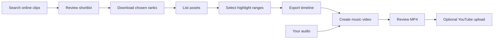

# Scripts Studio

The default interface is now a local browser dashboard with an Overview,
task cards, searchable tools, Activity & results, a script explorer, and the
workspace cleaner. Double-click the launcher to start it. Use the bottom-left
**Quit Studio** button when finished; closing a browser tab alone leaves the
local runner available. The earlier Tkinter interface remains available with
`python script_manager.py --desktop`.

The dashboard binds only to `127.0.0.1`, uses a random session token, and loads
its interface assets locally. Tools still perform their own downloads or uploads
when explicitly run. No extra web framework, Node server, or cloud hosting is
required. The session link is opened by the launcher. If using a console, you
can run `python script_manager.py --no-browser` and open the printed session link.

## Dashboard workflow

**Find & download clips** is a direct sidebar option and the destination of
the home clip card. Enter an idea/title or keywords, select a download count,
and run it; no audio is required. Successful downloads appear with previews and
**Use clips in a music video** to fill the creator's visuals folder. Advanced
settings hold optional audio context, extra keywords, mood, and candidate count.

Choose **Create a video**, **YouTube & Shorts**, or **Find the right clips** on
Overview. The forms show common inputs first and keep Python settings and
extra arguments under **Advanced settings**. Audio-only master exports hide
visual inputs; full video exports clear the preview-only range fields.

Job progress stays visible in a bottom activity bar. A completed video can be
previewed directly in its result panel or from **Activity & results**. Logs are
available under **View job log**; **Open job folder** opens the files on disk.
The cleaner is now a full page with Cleanup preview and Studio Trash sections.
Its protection rules and restore behavior are the same as the desktop cleaner.

Use **Ctrl K** for tool search. The dashboard adapts to smaller windows with
a collapsible sidebar. No media job starts just by opening a task card.

The following desktop instructions also describe the existing underlying tools.

Double-click **Start Scripts Studio.cmd** at the workspace root, or run:

```powershell
python script_manager.py
```

## Use a guided tool

1. Pick a tool under **Guided tools**. The tools are grouped into video/audio,
   the clip library, search/publishing, diagnostics, and the Soudeni project.
2. Choose files and enter the inputs marked `*`. Relative paths resolve from
   the workspace root. The Python environment (in **Advanced**) initially uses the interpreter
   running Studio; change it to another environment's `python.exe` when needed.
3. Use **Preview** to validate inputs and see the command in **Advanced**.
4. Click **Run tool**. Activity shows status, elapsed time, progress, and logs.
   One job runs at a time. **Stop** stops that job and its subprocesses.
5. Use **Job folder** or **Recent jobs** to read the saved log and status.
   The script's own outputs stay in its normal locations, shown in its log.

The video tool supports preview, full video, and audio-only WAV master exports.
Preview start/length can be left blank for the workflow defaults; clear them
when choosing a full video or master. An exported timeline takes precedence
over the photos/clips folder. Normalization defaults to off. The uploader
defaults to private, and uploads only when you explicitly run that tool.

## Workspace cleaner

Click **Cleaner** in the top toolbar after jobs have finished. Choose Python
caches and/or completed Studio job logs, set the minimum age (default seven
days; zero includes today's files), and click **Scan**. Scanning changes no files.
Review the folders and sizes, select the entries you want, then click
**Move selected to Trash**. Inputs, original media, generated videos, reusable
clip assets, credentials, model weights, environments, and vendor tools are
outside the cleanup categories. Job folders marked running are excluded.

The **Studio Trash** tab lets you **Restore selected** batches. Restore skips
existing locations instead of overwriting them. **Empty selected permanently**
asks for confirmation and removes the selected trash batches to free disk space.
Moving to Trash alone does not free space. Quarantined files are held under
`runs/.trash/cleaner/`. Files changed since a preview are skipped; scan again.
Linked paths and Windows junctions are excluded.

For a read-only command-line preview, use
`python tools/workspace_cleaner.py --days 7`. The hidden widget check
`python script_manager.py --ui-smoke` builds all guided forms and the cleaner
without running media scripts or cleaning the workspace.

## Typical video workflow

**AutoCrop Vertical: reframe video** is available under **Video & audio**.
Run **Setup AutoCrop Vertical** under **Setup & maintenance** once, then choose
a completed video to convert to YouTube 16:9, Shorts 9:16, 4:5, or 1:1.
The form defaults to **16:9 + 1080p (1920x1080)**; 720p and native size are also
available. See the
[AutoCrop guide](../modules/autocrop_vertical/README.md) for setup, quality
options, analysis-only mode, and the landscape-to-vertical workflow.



Copy candidate report paths, asset IDs, and highlight references from completed
logs into the next tool. Discovery is based on metadata and your visual keywords;
it does not watch scenes or select meaningful timestamps automatically. Timeline
coverage must match your preview or full song. The studio connects the existing
tools; their dependencies, credentials, and current limitations still apply.

## All scripts

The **All scripts** tab discovers first-party Python and PowerShell scripts and
lists command launchers. Search by filename or description. **Source** reads
the file inside Studio without importing or executing it. Shared source files,
tests, and command wrappers are view-only; use their public tools instead.
Third-party dependencies, environments, cached media, and generated outputs
are excluded. Restart Studio to pick up newly added scripts.

Standalone scripts can run with **Extra arguments** in **Advanced**: put each argument on a
separate line, including the value on its own line. Do not add shell quotes:

```text
--audio
C:\Music\my song.wav
--preset
preview
```

Discovered scripts start with **Open an interactive console** selected, so
scripts that prompt for input can accept answers. Their output is shown in that
console, rather than captured into Studio's log. Guided jobs normally capture
their full output. Review older scripts before using them: some have fixed
inputs, overwrite their project outputs, upload content, or open a browser.
Selecting a script never runs it.

Jobs are recorded under `runs/script-manager/<timestamp-id>/` with `job.json`
and `output.log`. These describe the launched command and its exit status;
the media workflow's own manifests provide media validation details. A forced
machine shutdown may leave a historical job marked running.

The launcher uses Python's standard library and Tkinter. Tools still require
their own dependencies, such as FFmpeg, yt-dlp, music libraries, or the separate
Demucs environment. Start with **Workspace health check** to inspect setup.
For the CLI-only catalog, use `python script_manager.py --list`.
