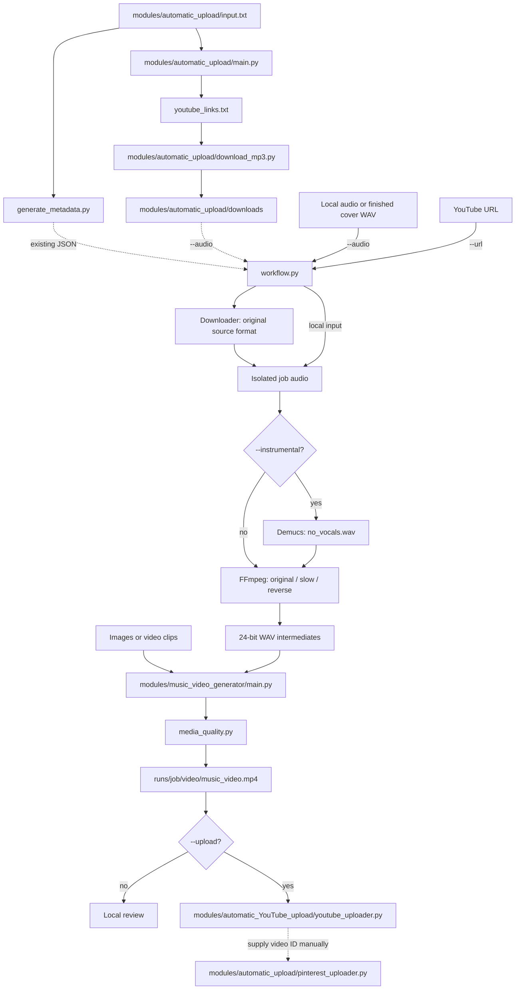
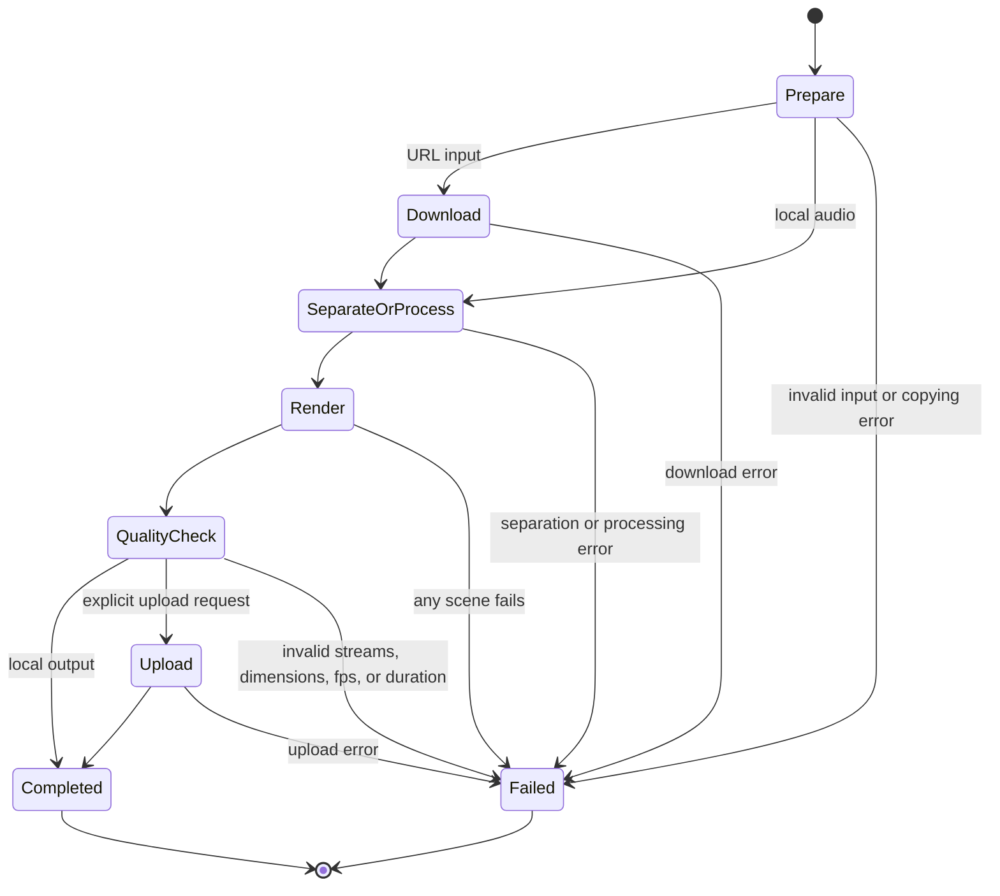
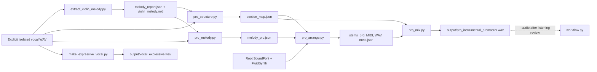
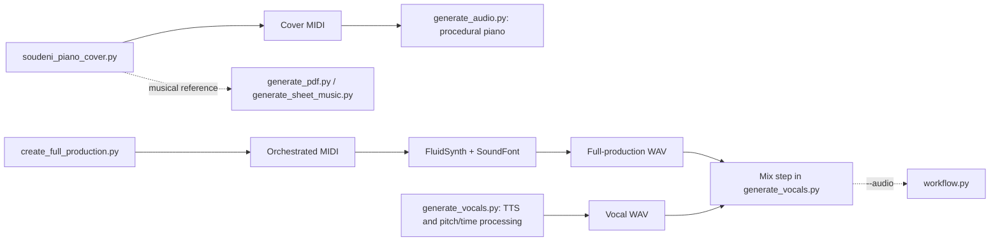

# How this workspace works

See [the current folder map](STRUCTURE.md) for the reorganized paths. Sections
about `violin-remix` and `soudeni_pro_cover` describe the earlier audit: those
folders were already absent when this organization started. The active root
song scripts now live in `projects/soudeni/`.

This is a collection of media utilities and song-specific production projects.
Use `workflow.py` for the shared audio-to-video path. The arrangement tools can
produce audio for that path, but they are separate production stages.

Read [the audit](AUDIT.md) for current verification results and remaining blockers.
For preview/master/video presets, reference comparisons, and optional
normalization, use [the production guide](PRODUCTION.md).

## 1. Overall connections

Solid arrows show executable handoffs in the integrated workflow. Dashed arrows
show a manual handoff: run the upstream tool, review its output, then supply that
file to the next tool. A line does not imply the service has been tested live.



`workflow.py` calls the downloader, renderer, and uploader as child processes. It
uses the Demucs engine from `modules/vocal-remover/.venv` directly rather than invoking
the older PowerShell stem-export wrapper. Slow/reverse processing also uses
FFmpeg directly; `song_processor/slow_reverse.ps1` remains a standalone utility.
The common engines are shared, while job-specific output paths prevent mixing files.

## 2. Folder responsibilities and verification

| Folder or group | Purpose | Input → output | Current evidence |
|---|---|---|---|
| Root `workflow.py`, `pipelines/media_quality.py` | Coordinate one media job | Local audio or URL + visuals → isolated video + manifest | Real local smoke tests and failure tests |
| `modules/automatic_upload/` | Search, download, metadata, Pinterest; also contains debugging experiments | Song names → URLs → audio; API key → metadata; video ID → Pinterest operations | Python syntax checked; downloader failure reporting tested with a simulated failure; external services unverified |
| `modules/music_video_generator/` | Analyze audio, schedule images/clips, render and mux | Audio + visuals + YAML → MP4 | Real single/playlist renders; short 1080p and beat checks are in the repeatable smoke suite |
| `modules/automatic_YouTube_upload/` | OAuth, resumable YouTube upload, thumbnail upload | MP4 + metadata → video ID + local upload receipt | CLI/import checked; thumbnail-failure recovery tested with a simulated service; no live upload |
| `song_processor/` | Standalone slow/reverse exports | `input/audio/` or explicit directory → `output/*_slow.wav`, `*_reverse.wav` | Standalone script produced both WAVs from a synthetic source; workflow also exercised both effects |
| `modules/vocal-remover/` | Demucs environment and stem-export wrappers | Song → separate instrumental and vocal WAV/MP3 | Runtime blocked by PyTorch DLL loading; full separation not verified |
| `violin-remix/` | Melody extraction, structure analysis, MIDI arrangement, mix processing | Vocal stem → JSON → MIDI/audio stems → premaster | Source checked; existing outputs measured; full regeneration not run |
| `soudeni_pro_cover/` | Song-specific instrumental generation and TTS vocal experiments | Hardcoded score/lyrics + SoundFont → audio | Bundled synth rendered a test note; complete arrangement/TTS not verified |
| Root `soudeni_*`, `generate_*`, `create_full_production.py` | Another song-specific score/audio/document pipeline | Hardcoded score → MIDI, WAV, PDF, MusicXML, optional TTS mix | Source checked and shared synth tested; full project not regenerated |
| `vendor/fluidsynth-bin/`, `assets/soundfonts/SoundFont.sf2` | Native MIDI renderer and instrument samples | MIDI → audio | Shared installation rendered a test note after relocation |
| `tools/` | Health checks, synthetic render tests, output measurements | Workspace/media → JSON reports | Repeatable local diagnostics |
| `tests/`, `test_workflow.py` | Offline regressions | Controlled fixtures/mocks → test results | Required-stage failures, upload receipts, timing, file discovery, quality checks |
| `runs/` | Job artifacts and technical reports | One subdirectory per invocation | Generated files; excluded from Git |
| `vendor/javascript/` | Separate JavaScript dependency installation | `ytdl-core` dependency | No JS entry point is wired into the Python workflow; Node itself is available |
| `tools/personal/browser_login.py` | Personal browser/login automation unrelated to media | Personal environment variables → interactive browser actions | Source only; not executed during media checks |
| `.git`, `.kilo` | Repository/editor working state | Internal tool data | Keep separate from media assets |

## 3. What one job contains

```text
runs/<date-time-id>/
  audio/                 copied inputs or new downloads
  images/                copies of this job's visual sources
  stems/htdemucs/.../     optional separated stems
  processed/             ordered 24-bit WAV inputs to the renderer
  config.yaml            video configuration with absolute job paths
  manifest.json          current stage, input paths, output, quality result, errors
  video/
    concatenated_audio.wav   lossless playlist intermediate when needed
    music_video.mp4          H.264 video with AAC audio
    music_video.upload.json  server video ID receipt when uploaded
```

Job inputs are copied, so the workflow preserves originals. It selects up to
`--max-songs` files in filename order, not filesystem modification order.
For explicit playlist order, use numbered names such as `01_intro.wav`.
All supported images/clips in `--images` are candidates. For playlists, the
renderer assigns one visual per song; for one song, it can use several visuals.
This is image selection by order, not semantic matching of artwork to a song.



A failed job remains available for inspection. Automatic resume of `workflow.py`
jobs is not implemented: rerunning creates a new job. If an upload receipt exists,
inspect that video ID before uploading again. Remote success followed by a local
disk/network interruption cannot be made perfectly transactional.

## 4. The song-production branches

These are creative projects, not generic converters. Their scores, voicings,
lyrics, instrument programs, processing settings, and output names are specialized.
Changing one song's source does not automatically make its arrangement suitable
for every other song.



The violin tools now share `project_paths.py`. Set `VOCAL_SOURCE` to a specific
stem, or use `--vocals` on the extractor. Automatic selection only works when
there is exactly one stem candidate. This avoids silently analyzing one song and
arranging another. The analysis/arrangement stages still write into this project
folder: finish and archive one project before starting a different source.

```powershell
$env:VOCAL_SOURCE = (Resolve-Path "modules/vocal-remover/output/vocals/song.wav").Path
py -3.11 violin-remix/extract_violin_melody.py
py -3.11 violin-remix/pro_structure.py
py -3.11 violin-remix/pro_melody.py
py -3.11 violin-remix/pro_arrange.py
py -3.11 violin-remix/pro_mix.py
py -3.11 workflow.py --audio violin-remix/output/pro_instrumental_premaster.wav
```

Install `violin-remix/requirements.txt` in the interpreter used for those stages.
The existing violin environment and the Demucs environment have different
dependencies; they are not interchangeable.

The root song project has another route:



The PDF and notation generators contain their own score data; they do not
automatically synchronize every change made to the MIDI arrangement. TTS plus
pitch shifting is an experiment, not evidence of convincing sung vocals. No
listening approval is implied by filenames containing “professional” or “pro”.

## 5. Commands to use

From the workspace root:

```powershell
.\run.ps1 doctor
.\run.ps1 test
.\run.ps1 smoke
.\run.ps1 workflow -Audio "path/to/song.wav"
.\run.ps1 workflow -Audio modules/automatic_upload/downloads -Effect slow
.\run.ps1 workflow -Audio "path/to/song.wav" -Images "path/to/artwork"
```

Direct Python provides all options:

```powershell
py -3.11 workflow.py --help
py -3.11 workflow.py --audio "song.wav" --effect reverse --max-songs 1
py -3.11 workflow.py --url "https://www.youtube.com/watch?v=VIDEO_ID"
py -3.11 workflow.py --audio "song.wav" --config "custom-video.yaml"
py -3.11 workflow.py --audio "song.wav" --metadata "metadata.json" --upload --privacy private
```

`--instrumental` depends on repairing the currently failing Demucs runtime.
The default workflow creates local output. Upload happens only with `--upload`.

The metadata generator reads song names separately. Review its result and pass
its JSON explicitly. The uploader's older metadata fallback can choose the first
entry when the generic video filename does not match a song: for compilations,
use the batch metadata builder or supply a reviewed title/description directly
to the uploader. Pinterest is a separate manual step, not an automatic post-upload
stage of `workflow.py`.

For batch work, start with `py -3.11 pipelines/batch_pipeline.py --skip-upload --max-batches 1`.
Its download/search stage contacts YouTube. It still defaults to uploading when
`--skip-upload` is absent and can delete local videos after a recorded upload;
use `--keep-videos` when retaining outputs. Batch progress now keys songs by
content rather than only batch number. Older numeric progress keys are retained
on disk but are not automatically migrated; reconcile their video IDs before a
new upload run. Batch filenames remain numbered: avoid concurrent batch jobs.

## 6. Management and quality routine

1. Use one interpreter per workflow. `requirements/workflow.txt` records the
   direct versions used in this audit, not a complete transitive lock. Install
   it in a dedicated environment rather than upgrading unrelated global tools.
   Keep PyTorch/Demucs separate from video/analysis dependencies.
2. Put a job's source audio and artwork in explicit input folders. Keep scripts,
   source assets, intermediate files, final masters, and published IDs distinct.
   Preserve the `runs/<job>` manifest alongside any final deliverable.
3. Run `doctor` after dependency changes, unit tests after code changes, and
   `smoke` after renderer/configuration changes. `doctor` currently returns a
   nonzero exit status for the Demucs failure and global dependency conflicts.
4. Before a real upload, inspect the whole video, listen to the mix, check song
   order/artwork/metadata, and review the quality results. The technical gate
   catches missing streams, mismatched duration, resolution, and frame rate;
   the smoke suite additionally decodes complete short outputs.
5. Retain 24-bit or float WAV masters. MP3/AAC are distribution encodings; converting
   an already lossy source to WAV does not restore lost detail. Prefer WAV inputs
   from the arrangement/separation tools for further editing.
6. Keep credentials in local environment variables or ignored credential files.
   `.gitignore` does not remove files already tracked by Git. The root OAuth
   client configuration remains tracked and needs a separate repository-history
   decision. The removed browser passwords should be treated as previously exposed.
7. Archive selected final jobs explicitly. `runs/` can grow substantially. No
   automatic cleanup was performed. The later folder organization is recorded
   in `folder-moves.json`. Older
   `clean` targets can remove inputs/outputs; inspect their code before use.

## 7. Reports and how to refresh them

| Artifact | Meaning | Refresh command |
|---|---|---|
| [health-check.json](health-check.json) | Syntax, package presence, tool versions, environment and dependency checks | `py -3.11 tools/doctor.py --output docs/health-check.json` |
| [media-smoke.json](media-smoke.json) | Actual synthetic media processing and decoding | `py -3.11 tools/smoke_media.py` |
| [synth-smoke.json](synth-smoke.json) | Test-note rendering with both bundled synths | `py -3.11 tools/check_synth.py` |
| [audio-quality.json](audio-quality.json) | Full-file measurements of three existing instrumental WAVs | `py -3.11 tools/audio_quality.py <file.wav> --output docs/audio-quality.json` |

Reports are snapshots. A passing short synthetic render is not a performance or
listening assessment of a full song, and source syntax passing does not certify
that a browser automation service or external API currently works.
